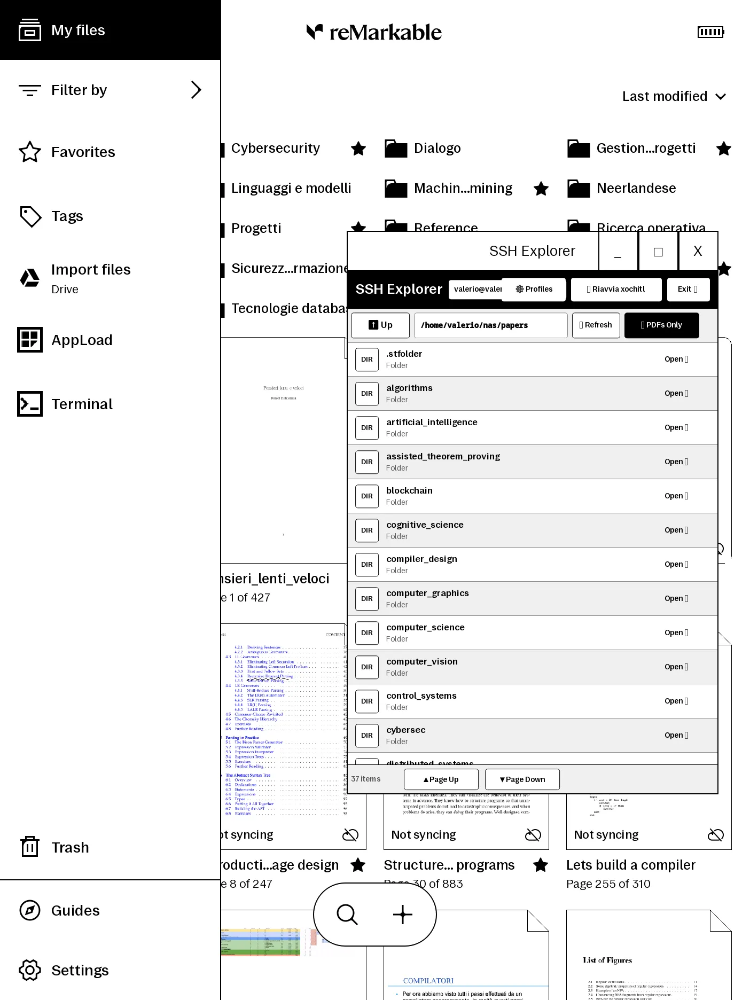

# SSH Explorer for reMarkable 2

[](https://remarkable.com/products/remarkable-2)

**SSH Explorer** is a native file browser and PDF importer for **reMarkable** tablets, built on the [**AppLoad**](https://github.com/asivery/rm-appload) ([XOVI](https://github.com/asivery/xovi)) ecosystem. It allows you to browse remote file systems over SSH and download PDF documents directly into your reMarkable library.

<p align="center">
  
</p>

---

## Features

- **E-Ink Optimized UI:** High-contrast monochrome interface designed for minimal flicker, with dedicated Page Up / Page Down controls.
- **On-Screen Touch Keyboard:** Integrated virtual keyboard for typing hosts, paths, and credentials directly on the tablet.
- **Connection Profiles:** Save, test, and delete multiple SSH profiles stored in `~/.config/ssh-explorer/config.json`.
- **Fast Directory Traversal & Filters:** Browse remote folders with an integrated real-time search bar, quick filter toggles for *PDFs Only* and *Hidden Files* (dotfiles), plus human-readable file sizes.
- **⚡ Smart No-Restart PDF Import (USB Web Server Loopback):**
  - **Live Library Refresh:** Uploads documents directly through reMarkable's internal web server (`http://10.11.99.1/upload` via loopback). Documents appear in the `xochitl` library **instantly without restarting the UI** and without closing SSH Explorer!
  - **Background Worker & Non-Blocking Polling:** Handles large documents (textbooks, manuals, 10–200+ MB) seamlessly in the background without being constrained by GUI thread timeouts.
  - **Zero-Deadlock Kernel Probe:** Instantly detects web server status via `/proc/net/tcp` without network socket contention.
  - **Graceful Fallback:** If the internal web server is inactive, it seamlessly falls back to direct storage creation (`~/.local/share/remarkable/xochitl/`) with a 1-tap **Restart xochitl now** option.
- **Lightweight & Self-Contained:** No Python, Node.js, or heavyweight runtimes required on device. Powered by standard POSIX shell tools, Dropbear, and XOVI's CommandExecutor.

---

## Device Requirements

* **Device:** reMarkable 2 (OS 3.x / Yocto Linux armv7).
* **Installed Vellum packages:**
  * `appload`
  * `xovi` & `xovi-extensions`
  * `qt-command-executor`
  * `qt-resource-rebuilder`
* **SSH Client:** Dropbear (`dbclient` / `ssh`) with configured identity keys (e.g. `/home/root/.ssh/id_dropbear` or `id_rsa`).

---

## Architecture

```
┌─────────────────────────────────────────────────────────────────┐
│                    xochitl (reMarkable OS UI)                   │
│                    ▲                         │                  │
│   [Live Model Sync]│                         │ AppLoad          │
│                    │                         ▼ Extension        │
│          ┌──────────────────────────────────────────────┐       │
│          │                 SSH Explorer                 │       │
│          │     (QML: ConnectionView, ExplorerView,      │       │
│          │      VirtualKeyboard, ImportModal)           │       │
│          └──────────────────────┬───────────────────────┘       │
│                                 │ Fast Non-Blocking Polling     │
│          ┌──────────────────────▼───────────────────────┐       │
│          │     Background Worker (ssh-helper.sh)        │       │
│          └───────────┬───────────────────┬──────────────┘       │
│                      │                   │                      │
│             [Loopback HTTP POST]         │                      │
│              http://10.11.99.1/upload    │                      │
│                      │                   │                      │
└──────────────────────┼───────────────────┼──────────────────────┘
                       │                   │
             [ Dropbear SSH / SCP ]        │ [ Direct Storage Write ]
                       │                   ▼   (Fallback)
                       │          reMarkable Storage
                       │       (/home/root/.../xochitl)
                       ▼
             [ Remote SSH Server ]
```

---

## ⚡ No-Restart Library Refresh (Loopback Architecture)

In stock reMarkable OS, writing documents directly to storage (`/home/root/.local/share/remarkable/xochitl/`) does not automatically refresh the library because `xochitl` does not watch the directory for changes. Users traditionally had to restart the entire `xochitl` GUI service (`systemctl restart xochitl`), which kills all running applications, flashes the screen, and takes 5–10 seconds.

SSH Explorer solves this by performing an internal **loopback upload**:
1. When a PDF is downloaded, the background worker sends a `POST /upload` request to `http://10.11.99.1/upload`.
2. `xochitl`'s embedded web server ingests the document directly inside its own process memory, updates its Qt document models, renders thumbnails, and displays the document live in your library in under 1 second.
3. The UI smoothly displays real-time progress (*Downloading...* $\rightarrow$ *Ingesting...* $\rightarrow$ *Live in Library!*).

---

## Enabling No-Restart Mode on Wi-Fi

`xochitl`'s built-in web server normally listens on `10.11.99.1:80` only when a physical USB-C cable is connected. To keep it accessible permanently over Wi-Fi, choose one of the following methods:

### Method 1: Using `webinterface-onboot` (Recommended)

[`webinterface-onboot`](https://github.com/rM-self-serve/webinterface-onboot) is the community standard tool to keep the web server running on boot.

#### Option A: Via Toltec (if installed on device)
```bash
opkg update
opkg install webinterface-onboot
systemctl enable --now webinterface-onboot
```

#### Option B: Offline / Bundled Backup (Included in this repo)
A complete offline backup of `webinterface-onboot` is provided in [`tools/webinterface-onboot/`](file:///home/valerio/source/remarkable/ssh-explorer/tools/webinterface-onboot/):
```bash
# Copy and install from repository
scp tools/webinterface-onboot/webinterface-onboot root@remarkable:/home/root/.local/bin/
scp tools/webinterface-onboot/webinterface-onboot.service root@remarkable:/lib/systemd/system/

ssh root@remarkable "chmod +x /home/root/.local/bin/webinterface-onboot"
ssh root@remarkable "/home/root/.local/bin/webinterface-onboot apply-hack -y"
ssh root@remarkable "/home/root/.local/bin/webinterface-onboot apply-prstip -y"
ssh root@remarkable "systemctl daemon-reload && systemctl enable --now webinterface-onboot"
ssh root@remarkable "systemctl restart xochitl"
```
*(For detailed documentation and rollback instructions, see [tools/webinterface-onboot/README.md](file:///home/valerio/source/remarkable/ssh-explorer/tools/webinterface-onboot/README.md)).*

---

### Method 2: Standalone ARM Binary Patcher (No external dependencies)

If you prefer not to install system services, this repository includes a standalone ARMv7 patcher that modifies the carrier check instruction in `xochitl`:
```bash
# Apply patch on device with automatic backup
./tools/toggle-webinterface-patch.sh patch

# Revert to 100% stock at any time
./tools/toggle-webinterface-patch.sh restore
```

---

### Method 3: Active USB Cable (Zero modifications)

If you connect your reMarkable to a PC via USB-C cable and toggle **Settings $\rightarrow$ Storage $\rightarrow$ USB web interface ON**, loopback works out of the box with zero modifications.

---

## Quick Start

### 1. Build the Package

Run on your computer (`rcc` required):
```bash
./build.sh
```
This packages QML resources into `dist/ssh-explorer/resources.rcc` and creates `dist/ssh-explorer.tar.gz`.

### 2. Deploy to reMarkable 2

Over USB (default IP `10.11.99.1`):
```bash
./deploy.sh
```

Or specify a Wi-Fi IP address or hostname:
```bash
./deploy.sh remarkable
```

### 3. Launch

1. Open the **AppLoad** launcher on your reMarkable tablet.
2. Tap **SSH Explorer** to launch.
3. The top bar shows **`[⚡ No-Restart]`** when the loopback web server is active.

---

## Project Structure

```
ssh-explorer/
├── manifest.json                        # AppLoad descriptor
├── application.qrc                      # Qt resource compiler descriptor
├── icon.png                             # Launcher icon (200x200)
├── ssh-helper.sh                        # POSIX backend helper (SSH transfer, loopback, config)
├── build.sh                             # Build & packaging script
├── deploy.sh                            # One-step SSH deployment script
├── res/
│   └── screenshot.webp                  # Application screenshot
├── tools/
│   ├── webinterface-onboot/             # Bundled upstream webinterface-onboot backup & guide
│   │   ├── README.md                    # Installation & rollback guide
│   │   ├── webinterface-onboot          # Upstream executable script
│   │   ├── webinterface-onboot.service  # Systemd service unit
│   │   └── install-webint-ob.sh         # Upstream installer script
│   ├── arm_patcher                      # Standalone ARMv7 binary patcher
│   ├── toggle-webinterface-patch.sh     # Safe binary patch toggler with backup/restore
│   └── loopback-experiment.sh           # Diagnostic & benchmarking tool
├── ui/
│   ├── main.qml                         # App root, async background jobs & top bar
│   ├── Style.qml                        # E-Ink palette, metrics, and typography
│   ├── qmldir                           # QML module definition
│   ├── ConnectionView.qml               # Profile manager & connection form
│   ├── ExplorerView.qml                 # Remote file browser & pagination
│   ├── VirtualKeyboard.qml              # On-screen touch keyboard
│   └── ImportModal.qml                  # Download progress & import confirmation modal
└── preview/                             # Linux desktop Qt5 test runner
```
